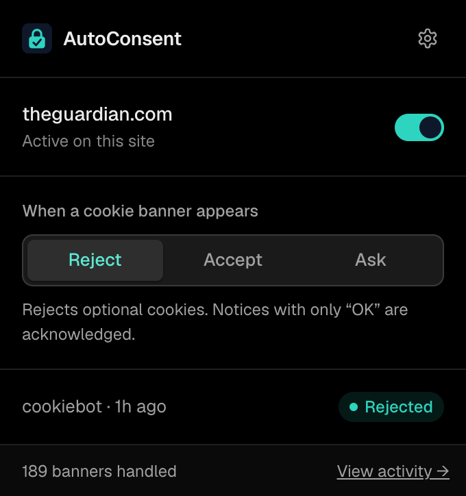
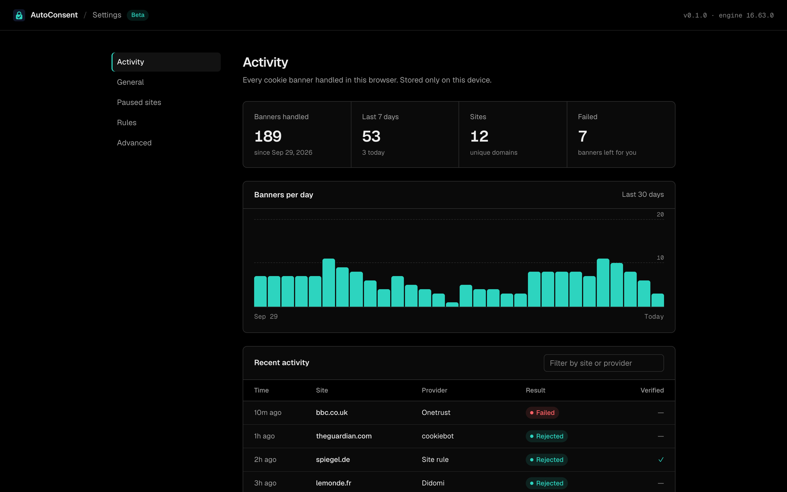
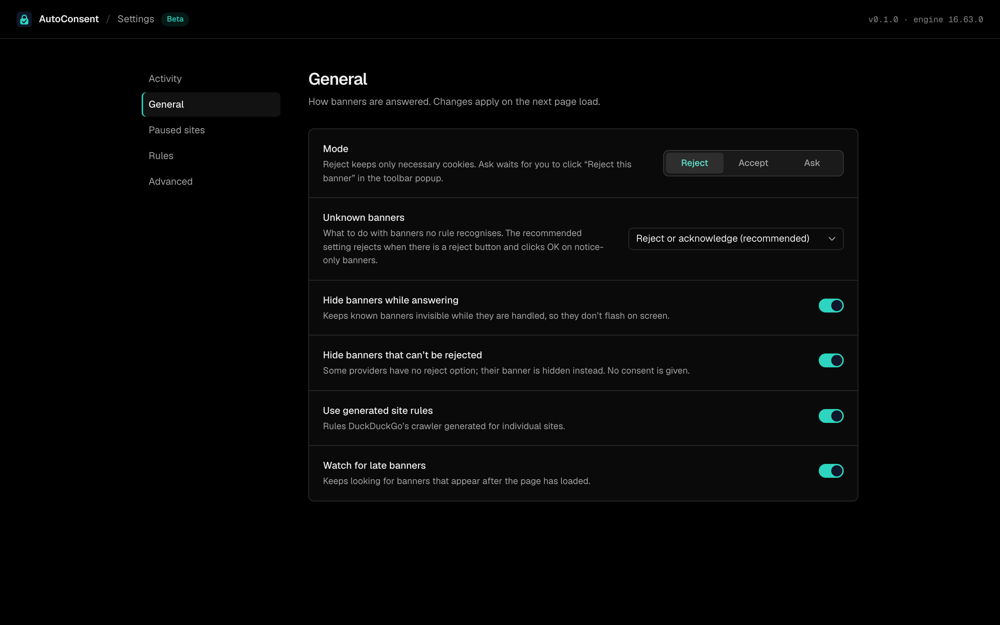

<p align="center">
  
</p>

<h1 align="center">AutoConsent</h1>

<p align="center">
  Rejects cookie banners for you, keeping only necessary cookies.<br />
  A Chromium extension built on DuckDuckGo’s autoconsent engine.
</p>

<p align="center">
  <a href="https://github.com/timblazing/autoconsent/releases"></a>
  
  <a href="../LICENSE"></a>
</p>

> [!NOTE]
> AutoConsent is in **beta**. It works day to day, but expect rough edges. It isn’t on the Chrome Web Store yet; install it from a release for now.

<p align="center">
  
</p>

## What it does

Most “accept all cookies” extensions click **Accept**. AutoConsent does the opposite. When a cookie banner appears, it finds the reject or “necessary only” option and clicks it, so sites only set the cookies they need to work. Banners that offer nothing but an “OK” are acknowledged. Banners with no way to refuse are hidden, never accepted.

- **Rejects by default.** It recognizes hundreds of consent platforms (OneTrust, Didomi, Cookiebot, Sourcepoint, Quantcast, Usercentrics and more) plus site-specific rules.
- **Handles unknown banners too.** A text-based fallback rejects or acknowledges banners that no rule recognizes.
- **Three modes:** Reject (default), Accept, or Ask, where it detects the banner and waits for you to click **Reject this banner** in the popup.
- **Per-site pause.** Turn it off for any site that misbehaves, from the popup or the settings page.
- **Activity history.** See which banners it handled, where, with which provider, and whether it worked.
- **Private.** No accounts, no analytics, no network requests. Rules ship inside the extension, and the activity log never leaves your browser.

## Screenshots





## Install

1. Download `autoconsent-v*.zip` from the [releases page](https://github.com/timblazing/autoconsent/releases) and unzip it somewhere permanent. The browser loads it from that folder, so don’t delete it.
2. Open `chrome://extensions` (or `helium://extensions`, `brave://extensions`, `edge://extensions`).
3. Turn on **Developer mode**.
4. Click **Load unpacked** and pick the unzipped folder.
5. Pin AutoConsent to the toolbar. The icon shows a check once a banner on the page has been handled.

Works in Chrome, Edge, Brave, Arc, Helium and other Chromium browsers. To update, unzip the new release over the same folder and click reload on the extension card. Your settings and history are kept.

## Settings

Open settings from the gear in the popup, or right-click the toolbar icon and choose **Options**.

| Page | What’s there |
| --- | --- |
| **Activity** | Totals, banners per day, a searchable log of every banner, and a per-provider breakdown. |
| **General** | Mode, what to do with unrecognized banners, and switches for hiding banners while they’re answered, cosmetic hiding, generated site rules and late-appearing banners. |
| **Paused sites** | Domains AutoConsent leaves alone. |
| **Rules** | Turn individual consent-platform rules on or off. |
| **Advanced** | Click highlighting, detection attempts, console logging, clearing history and resetting settings. |

## Build from source

Requires Node.js 20 or newer.

```bash
git clone https://github.com/timblazing/autoconsent.git
cd autoconsent
scripts/personal/build.sh      # builds into ./extension, then load it unpacked
scripts/personal/update.sh     # merges the latest DuckDuckGo rules and engine, then rebuilds
scripts/personal/release.sh    # builds and zips a release into ./dist
```

AutoConsent’s own code lives in [`addon/personal/`](../addon/personal) and [`scripts/personal/`](../scripts/personal). Everything else is the upstream engine, kept as-is so new rules can be merged in easily. [`PERSONAL.md`](../PERSONAL.md) explains the layout.

## Roadmap

- Chrome Web Store release
- Firefox build
- Export and import of settings and paused sites

Found a banner it missed or a site it broke? [Open an issue](https://github.com/timblazing/autoconsent/issues/new) with the URL and your mode.

## Credits

- **[DuckDuckGo autoconsent](https://github.com/duckduckgo/autoconsent)** does the hard part: the consent-platform rules, detection and the opt-out engine. AutoConsent is a fork that adds its own interface, activity log and branding. Thank you to the DuckDuckGo team and every rule contributor.
- **[Consent-O-Matic](https://github.com/cavi-au/Consent-O-Matic)** by Aarhus University inspired the activity statistics.
- **[Geist](https://vercel.com/font)** typeface by Vercel, under the SIL Open Font License.

AutoConsent is not affiliated with or endorsed by DuckDuckGo.

## License

[Mozilla Public License 2.0](../LICENSE), the same license as upstream autoconsent.
